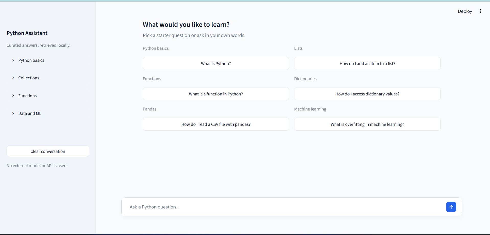
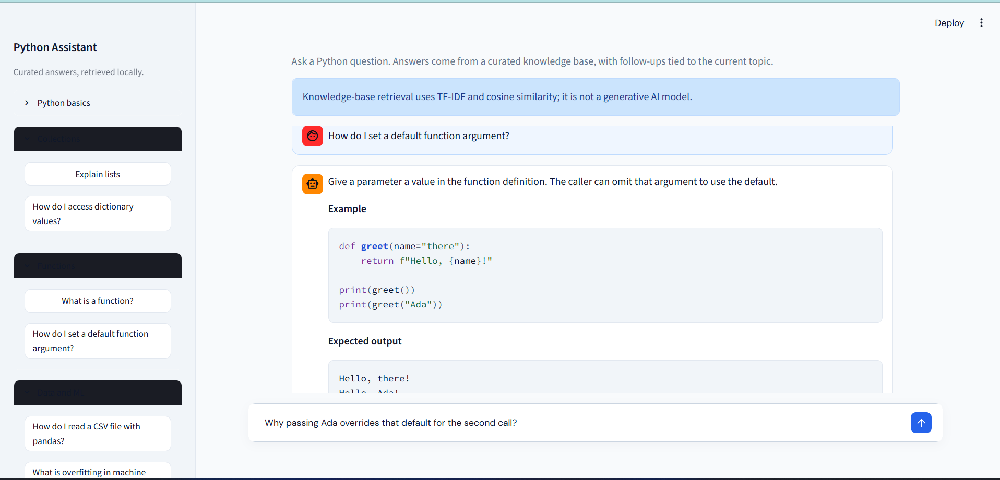

# Personal Python Question-Answering Chatbot

A local Streamlit chatbot for asking natural-language questions about Python. It retrieves concise answers and runnable examples from a curated knowledge base, and maintains a small amount of deterministic conversational context for common follow-ups.

The primary chatbot uses a predefined knowledge base, TF-IDF, and cosine similarity. It does not use a generative model, call an external AI API, or require API keys.

## Features

- More than 70 curated question-and-answer entries covering Python basics, data types, strings, lists, tuples, dictionaries, sets, control flow, functions, OOP, exceptions, files, modules, virtual environments, pip, NumPy, pandas, and introductory machine learning.
- Normalized question matching over canonical questions, curated aliases, and keywords with word and character n-grams.
- Conservative similarity threshold and cross-topic ambiguity rejection with a helpful fallback.
- Deterministic follow-ups for Python use cases, list insertion, function examples, dictionary access, deeper explanations, line-by-line code walkthroughs, and another example; asks for clarification when the topic is missing or ambiguous.
- Beginner-friendly answers with concise explanations, syntax, runnable examples, expected output, and line-by-line notes where useful.
- A compact chat interface with topic prompts, scrollable conversation history, code formatting, a clear-conversation action, and answer-source details hidden until requested.
- Local-first operation with no API key or paid service.

## Screenshots





## Technologies

- Python 3.10 or newer
- Streamlit for the chat interface and session state
- scikit-learn for TF-IDF vectorization and cosine similarity
- pytest for automated tests

## Retrieval and context

Each knowledge-base entry stores a canonical question, answer, category, keywords, optional alternate phrasings, and optional context topic. A combined word/character TF-IDF vector representation ranks entries by cosine similarity. Exact curated question and alias matches are resolved directly; other questions must pass a minimum similarity threshold and cannot be a near-tie across different topics. Similarity scores are ranking signals, not probabilities of correctness.

The app keeps the latest resolved question, answer, category, and topic in Streamlit session state. Deterministic follow-up intents can explain the previous answer in more detail, walk through its fenced code line by line, or show another example for the same topic. Existing follow-ups such as Python use cases and list/dictionary operations remain topic-aware. Explicit new topics use normal retrieval instead of inheriting the old topic; unsupported questions clear it; and ambiguous follow-ups ask for clarification. Clearing the conversation resets both messages and topic context.

## Windows setup

Open PowerShell in the project directory:

```powershell
py -m venv .venv
.venv\Scripts\Activate.ps1
python -m pip install --upgrade pip
python -m pip install -r requirements.txt
```

If PowerShell blocks activation, use the environment interpreter directly:

```powershell
.venv\Scripts\python.exe -m pip install -r requirements.txt
```

## Run the app

```powershell
python -m streamlit run app.py
```

Open the local URL printed by Streamlit, usually `http://localhost:8501`. Choose a starter prompt, use a topic in the sidebar, or type into the composer. The **Clear conversation** action resets both chat history and follow-up context.

## Example questions

- `What is Python?` then `So then where is this used?`
- `Explain lists` then `How do I add an item to it?`
- `What is a function?` then `Show me an example.`
- `What is a dictionary?` then `How do I access its values?`
- `What is a function?` then `I didn't understand, explain in more detail`
- `How do I read a CSV file with pandas?` then `What does this code mean?`
- `How do I read a CSV file with pandas?`
- `How do I install a Python package with pip?`

## Tests and dependency check

```powershell
python -m pytest
python -m pip check
```

Tests are deterministic and do not call an external API or require internet access. If pytest's default file-descriptor capture cannot create a temp file in a restricted Windows environment, use:

```powershell
$env:PYTEST_ADDOPTS = "--capture=sys"
python -m pytest
Remove-Item Env:PYTEST_ADDOPTS
```

## Limitations and future improvements

The bot is limited to topics and answers in its curated knowledge base; it is not a general-purpose Python assistant and does not execute code. Similarity scores are ranking signals rather than probabilities, so a close match may still be wrong; questions below the threshold or ambiguous across topics are left unanswered. Follow-up handling is deterministic and recognizes only a limited set of patterns, and its additional explanations and examples come from predefined templates and content rather than a generative model. A future improvement could add reviewed knowledge-base entries, feedback-driven evaluation cases, or an optional separately configured generative fallback. Such a fallback is not included or required by this project.